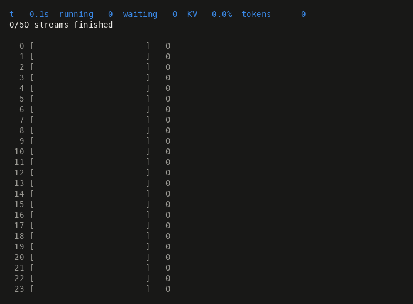
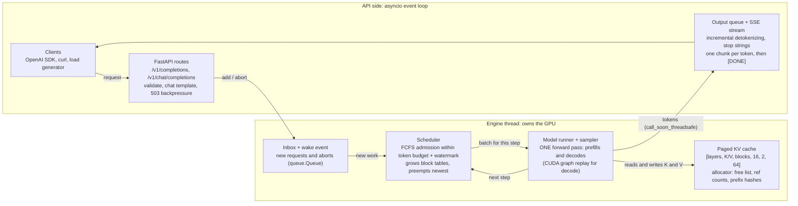
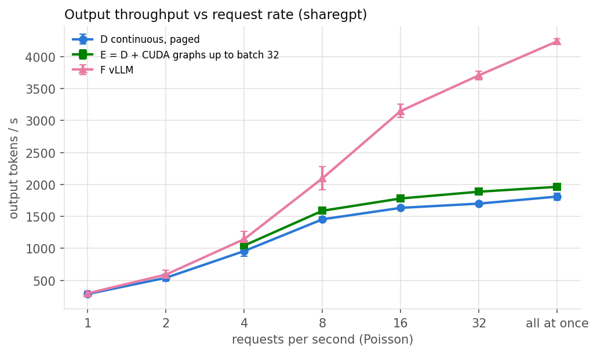
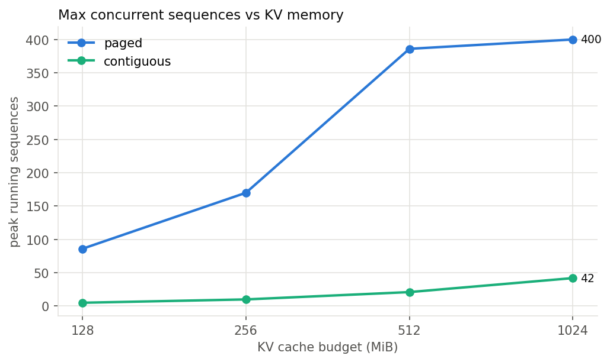
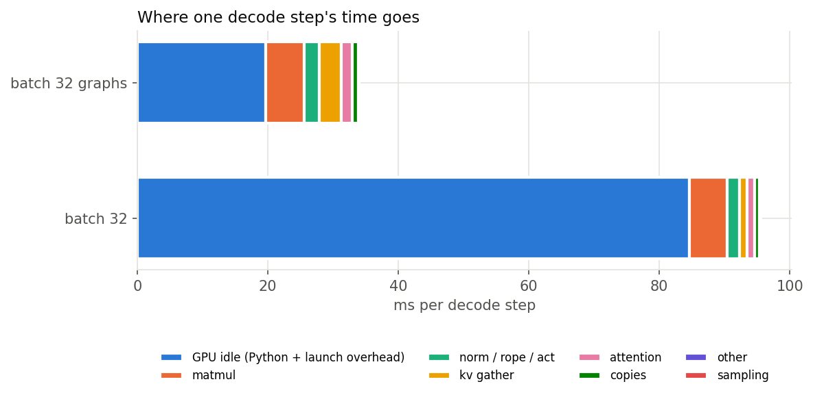
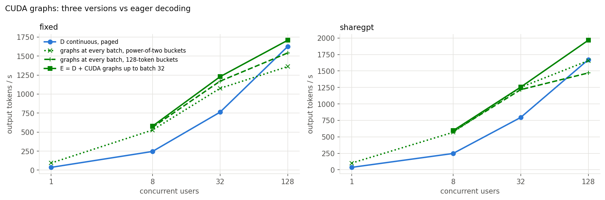

# infer — an LLM inference server built from scratch in PyTorch

`infer` serves **Qwen2.5-0.5B-Instruct** to many users at once from a single GPU. It runs its own
Qwen2 forward pass (no `generate()`), batches continuously at every decode step, stores the KV cache
in a **paged block pool with preemption**, streams tokens over an **OpenAI-compatible SSE API**, and
exposes Prometheus metrics. A benchmark suite compares it against naive HuggingFace serving, static
batching, a contiguous-cache variant of itself, and vLLM on the same T4.

> **Status.** Everything below is implemented and measured. On CPU the fast suite (97 tests, tiny
> model, ~3 min) and the real-weights suite (28 tests, ~12 min) pass, including the fp32 golden check
> through every engine configuration. On a Kaggle T4 the GPU tests (fp16 near-ties, CUDA-graph capture)
> pass and the full benchmark ran: ~17 GPU hours over nine notebook runs. Every number in this README
> comes from [`bench/results/`](bench/results/results.md) and is rebuilt by `python -m bench.plot`.



*50 chat requests streaming at once from one T4 (`bench/demo.py`): 49 running in one batch, KV cache
under 1%, all finished in 7 s.*

**See it:** [`docs/showcase/index.html`](docs/showcase/index.html) is an interactive results page (open it
from disk; `python -m bench.showcase` rebuilds its data from `bench/results`), and
[`docs/showcase/infer_demo.mp4`](docs/showcase/infer_demo.mp4) is a 3-minute narrated walkthrough: the real
server on a laptop CPU end to end, the T4 recording, and the results (made by the scripts in
[`docs/video/`](docs/video/README.md)).

## Contents

- [Architecture](#architecture) · [Quick start](#quick-start) · [What is implemented](#what-is-implemented)
- [Results](#results) · [Correctness](#correctness) · [Design decisions](#design-decisions)
- [Benchmark methodology](#benchmark-methodology) · [Limitations](#limitations) · [Repo layout](#repo-layout) · [References](#references)

## Architecture

Two threads split the work: the API side (asyncio event loop) handles HTTP, tokenization,
detokenization and streaming; the engine thread owns the GPU and runs one forward pass per step.



A request crosses to the engine through the inbox; the scheduler folds it into the next step's
batch. Each new token crosses back to that request's `asyncio.Queue` via
`loop.call_soon_threadsafe` and streams to the client. A disconnected client's generator is
cancelled; its `finally` block sends an abort down the same inbox and the engine frees the
sequence's blocks at its next step.

One engine step (`src/infer/engine/engine.py`):

```python
plan = scheduler.schedule()                     # who prefills, who decodes, who is preempted
tokens = runner.execute(plan.prefill_seqs, plan.decode_seqs)   # ONE forward pass + sampling
for seq, tok in zip(plan.seqs, tokens):         # append, stream, finish (frees blocks)
    ...
```

Inside the forward pass every token of the step sits side by side in one flat `[T, hidden]`
tensor. Per layer, attention first writes all new K/V into the pool with a single
`index_copy_` through the slot mapping (`slot = block_table[pos // 16] * 16 + pos % 16`), then
attends: prefills causally over their own fresh K/V, decodes over K/V gathered from their block
tables with a length mask. Grouped-query attention is done without copying K/V: the 7 query heads
sharing a KV head become 7 query rows of one single-head attention.

## Quick start

```bash
pip install torch            # CUDA or CPU wheel
pip install -r requirements.lock && pip install -e . --no-deps
```

Serve (fp16 on CUDA, fp32 on CPU; the KV pool is sized from free GPU memory unless capped):

```bash
python -m infer.serve --model Qwen/Qwen2.5-0.5B-Instruct --kv-cache-mb 512 --block-size 16 --max-num-seqs 128 --max-batched-tokens 2048 --port 8000
```

```bash
curl -N localhost:8000/v1/completions -H 'content-type: application/json' -d '{"prompt": "The capital of France is", "max_tokens": 32, "stream": true}'
```

```python
from openai import OpenAI
client = OpenAI(base_url="http://localhost:8000/v1", api_key="unused")
for chunk in client.chat.completions.create(model="Qwen/Qwen2.5-0.5B-Instruct", stream=True,
                                            messages=[{"role": "user", "content": "Explain KV caching."}]):
    print(chunk.choices[0].delta.content or "", end="", flush=True)
```

Benchmarks (on the GPU you report): `bash bench/run_all.sh`, then `python -m bench.plot` rebuilds
every figure and table from the raw JSON. Docker: `docker build -t infer . && docker run --gpus all -p 8000:8000 infer`.
Tests: `pytest -m "not real_model and not gpu"` (tiny random model, ~1 min on a laptop CPU, no download),
`pytest -m "real_model and not gpu"` (golden tests on the real weights, CPU fp32, ~12 min),
`pytest -m gpu` (fp16 and CUDA-graph checks; first run `python baselines/make_golden.py --fp16-only --device cuda`).

**Running on Kaggle (no git needed):**
1. `python scripts/make_kaggle_zip.py` → `dist/infer-server.zip` (with a `SOURCE_DIGEST` that every
   result file records in place of a git commit).
2. On Kaggle: Datasets → New Dataset → upload the zip (private).
3. Import `notebooks/kaggle_benchmarks.ipynb`, set Accelerator = GPU T4 x2 and Internet = on, attach the
   dataset (Add Input → Your Datasets), set `MODE` in the first code cell, and run all cells:
   `probe` (~30 min check of every GPU-only path), then `part1` (A–D + experiments, ~6 h),
   `part2` (E, F, Tier 2 extras, soak, ~6.5 h), `part3` (chunked prefill, demo GIF, ~25 min),
   `part4` (D at fixed user counts, ~1.5 h), `soak` (~45 min), and `part5`/`part6` (the CUDA-graph
   variants, ~1 h each). The split keeps each under Kaggle's 12-hour session limit; two can run at once.
4. Download `results_<MODE>.zip` from each run's Output tab, unzip them into this folder, and run
   `python -m bench.plot` to rebuild every figure and table from the combined raw JSON.

Useful flags: `--cache-type paged|contiguous`, `--engine continuous|static`,
`--policy prefill_first|decode_first`, `--preemption-mode recompute|swap`, `--enable-prefix-caching`,
`--enable-chunked-prefill` (with e.g. `--max-batched-tokens 512`), `--cuda-graphs` (tuned by
`--cuda-graph-max-batch`, `--cuda-graph-context-step`, `--cuda-graph-reserve-mb`), `--max-waiting 1000` (503 beyond it), `--request-timeout`, `--debug-steps` (one log
line per step: batch size, prefill/decode tokens, step ms, KV usage).

## What is implemented

| Plan part | Where | Notes |
|---|---|---|
| 1. Naive baseline (A) | `baselines/naive_hf.py`, `baselines/make_golden.py` | `/generate` + OpenAI route; asyncio lock held until `generate()` really stops (shielded join on disconnect); golden set + fp16 tolerance |
| 2. Model from scratch | `src/infer/model/` | safetensors loader with QKV and gate/up fusion and tied output; RMSNorm/RoPE casts mirror HF; contiguous single-sequence cache reference path |
| 3. Static batching (B) | `src/infer/engine/static_engine.py` | left padding, masks, per-row positions `mask.cumsum(-1) - 1`; B requests or W ms; waste counter |
| 4. Continuous batching (C) | `engine/scheduler.py`, `engine/engine.py`, `kv/contiguous.py`, `api/server.py` | step loop on its own thread, inbox + wake event, slot cache, SSE, incremental detokenization, stop strings, abort on disconnect |
| 5. Paged KV + preemption (D) | `kv/block_allocator.py`, `kv/paged_cache.py`, `kv/context.py` | block tables, slot mapping, batched write, gather-based paged attention, pool sizing + `--kv-cache-mb`, watermark admission, LIFO preemption by recompute **or swap** |
| 6. Scheduler, API, metrics | `engine/scheduler.py`, `api/`, `metrics.py`, `serve.py` | token budget, max seqs, prefill-first / decode-first, `/v1/completions`, `/v1/chat/completions`, `/v1/models`, `/health`, `/metrics`, 503 + Retry-After, per-request timeout |
| 7. Benchmarks | `bench/` | ShareGPT / fixed / mixed / shared-prefix workloads, async Poisson + concurrency load generator, `run_all.sh`, `plot.py`, offline KV/static/profiler/batch-1 experiments, soak test |
| 8. Stretch | `engine/cuda_graphs.py`, `kv/paged_cache.py`, `engine/scheduler.py` | **CUDA graphs** for small decode batches (batch × context buckets, eager above batch 32), **prefix caching** (block hashes, ref counts, LRU eviction) and **chunked prefill** (mixed steps: every decode plus prompt chunks in the leftover token budget) |
| Testing strategy | `tests/` | layer, logits, golden (fp32 exact), batch invariance, allocator properties (hypothesis), scheduler decisions, preemption, API contract, abort, GPU fp16 near-tie checks |
| Packaging | `Dockerfile`, `.github/workflows/ci.yml`, `requirements.lock`, `notebooks/` | CPU CI on every push (tiny model), golden job with cached weights, Kaggle notebook |

## Results

All systems serve Qwen2.5-0.5B-Instruct in fp16 on one Kaggle T4 (16 GB), max length 2,048, greedy,
`ignore_eos` with forced output lengths, three runs per point (mean ± std). Everything here is
generated by `python -m bench.plot` into [`bench/results/results.md`](bench/results/results.md), which
also has the full rate sweeps for every workload.

**Fixed workload, 512 tokens in / 128 out.** Throughput with 300 requests arriving at once; latencies
at 4 requests/s (A only ran all at once).

| System | Output tok/s | p50 TTFT (ms) | p99 TTFT (ms) | p50 TPOT (ms) | Max concurrent seqs |
|---|---|---|---|---|---|
| A naive HF | 34 ± 0 | 189272 | 374255 | 29.6 | – |
| B static batching | 451 ± 0 | 4316 | 7560 | 30.7 | 16 |
| C continuous, contiguous | 1701 ± 9 | 48 | 106 | 32.4 | 128 |
| D continuous, paged | 1686 ± 4 | 49 | 89 | 32.6 | 128 |
| graphs at every batch, power-of-two buckets | 1359 ± 10 | 38 | 71 | 16.4 | 128 |
| graphs at every batch, 128-token buckets | 1548 ± 10 | 38 | 67 | 14.0 | 128 |
| E = D + CUDA graphs up to batch 32 | 1677 ± 16 | 38 | 66 | 13.9 | 128 |
| F vLLM | 3439 ± 27 | 33 | 58 | 6.8 | 256 |

A serves one request at a time. "Max concurrent" is each server's batch cap (ours 128, vLLM's
default 256), so the fairer comparison with vLLM is a fixed number of users in flight. Our best
configuration, E, reaches **52–59% of vLLM's throughput** from 8 to 128 users (plain D: 23–51%); the
gap is per-token overhead, largest when few users share a step (see the profiler row below). The
three graph rows are the versions that led to E (Design decisions); the final E was not rerun at one
user, where it captures the same batch-1 graphs as the power-of-two row.

Fixed workload:

| System | 1 user: tok/s, p50 TPOT | 8 users: tok/s, p50 TPOT | 32 users: tok/s, p50 TPOT | 128 users: tok/s, p50 TPOT |
|---|---|---|---|---|
| D continuous, paged | 37, 27.3 ms | 246, 31.1 ms | 763, 35.7 ms | 1626, 52.3 ms |
| graphs at every batch, power-of-two buckets | 93, 10.6 ms | 527, 13.9 ms | 1076, 24.6 ms | 1362, 69.5 ms |
| graphs at every batch, 128-token buckets | – | 563, 12.9 ms | 1170, 22.2 ms | 1541, 59.5 ms |
| E = D + CUDA graphs up to batch 32 | – | 579, 12.5 ms | 1229, 21.4 ms | 1708, 49.9 ms |
| F vLLM | 158, 6.2 ms | 976, 7.6 ms | 2068, 14.2 ms | 3167, 34.6 ms |

ShareGPT (real prompts and reply lengths):

| System | 1 user: tok/s, p50 TPOT | 8 users: tok/s, p50 TPOT | 32 users: tok/s, p50 TPOT | 128 users: tok/s, p50 TPOT |
|---|---|---|---|---|
| D continuous, paged | 37, 27.0 ms | 248, 31.4 ms | 794, 35.9 ms | 1671, 54.0 ms |
| graphs at every batch, power-of-two buckets | 102, 9.4 ms | 568, 13.5 ms | 1252, 23.6 ms | 1656, 65.2 ms |
| graphs at every batch, 128-token buckets | – | 580, 13.3 ms | 1216, 23.9 ms | 1470, 71.8 ms |
| E = D + CUDA graphs up to batch 32 | – | 594, 13.0 ms | 1255, 23.1 ms | 1966, 53.1 ms |
| F vLLM | 164, 5.9 ms | 1057, 7.3 ms | 2410, 12.0 ms | 3815, 25.0 ms |

**What the experiments decided** (figures in `bench/results/figures/`):

| Question | Measurement | Result |
|---|---|---|
| Static vs continuous batching | same 64 mixed-length requests, offline | static wastes **47%** of slot-steps; continuous finishes **1.8×** faster (529 vs 298 tok/s) |
| | served, all at once | **3.7×** static's throughput on fixed (1,686 vs 451 tok/s), **8×** on mixed (2,134 vs 267) |
| Paged vs contiguous KV | 256 MiB pool, 400 ShareGPT requests, offline | **170 vs 10** concurrent sequences (**17×**); 2% vs 83% of allocated KV wasted (figure 4) |
| | full 12 GB pool | the same throughput (1,686 vs 1,701 tok/s): with this much memory the batch cap binds first |
| Block size 8 / 16 / 32 | 400 ShareGPT requests, 512 MiB, offline | waste 0.9 / 1.9 / 3.8%, throughput within 1% → 16 (figure 5) |
| Prefill-first vs decode-first | mixed, 8 req/s | decode-first: p99 TPOT **40 vs 55 ms**, but p50 TTFT **550 vs 53 ms** (figure 9) |
| Chunked prefill, 512-token budget | mixed, 16 req/s | p99 TPOT **67 → 50 ms**, p99 TTFT 10.4 → 6.4 s, +8% throughput; p50 TTFT +12 ms at 4 req/s |
| Prefix caching | 200 requests sharing a 1,000-token prefix, all at once | **2.5×** throughput (1,735 vs 682 tok/s), p50 TTFT 1.6 s vs 6.9 s |
| Recompute vs swap | 400 ShareGPT requests, 64 MiB pool, ~630 preemptions, offline | 502 vs 508 tok/s: a wash for a 0.5B model → recompute (no pinned memory) |
| Where a decode step goes | profiler, batch 32 | eager 95 ms, of which the GPU is idle 85 (~1,250 kernel launches); graphs: 34 ms, 4 launches (figure 6) |
| Batch 1 | 512 in, 128 out | decode 27.3 ms/token eager, **10.2** with CUDA graphs, 29.1 for HF `generate()` |
| Where CUDA graphs help | fixed workload, 8 / 32 / 128 users | graphs up to batch 32: **2.4× / 1.6× / 1.05×** eager D; graphs at every batch size were 5–16% *slower* than eager at 128 users |
| Leaks under sustained load | 30 min of Poisson arrivals at 4 req/s (`soak.json`) | **5,580 / 5,580** requests completed; at all 31 idle checks GPU memory and free KV blocks (65,652) identical to the byte |

Figures: 1 throughput vs request rate · 1b throughput vs users in flight · 2 p99 TTFT vs throughput ·
3 p50/p99 TPOT vs rate · 4 max concurrent sequences vs KV budget · 5 block-size ablation · 6 decode-step
breakdown · 7 batch size and KV usage over time · 8 static batching throughput vs batch size ·
9 one figure per experiment above · 10 the three CUDA-graph versions vs eager. Figures draw systems B–F
(A is a single point, in the table above).






Back-of-envelope numbers the measurements should be read against:

- **KV bytes per token** = 2 (K,V) × 24 layers × 2 KV heads × 64 dims × 2 bytes = **12 KiB**; a 16-token block is 192 KiB.
- **Decode is memory-bound:** every step reads ~1 GB of weights; at ~320 GB/s that is ≥ 3 ms per step whatever the batch, so batch 1 caps near ~320 tok/s and batch 32 lifts the ceiling toward ~10k tok/s before KV reads, compute and Python overhead pull it down.
- **Paged vs contiguous at a 256 MiB cap:** 21,845 tokens → 10 contiguous slots of 2,048, versus ~40 typical 500-token chat sequences in 16-token blocks: about **4× the concurrency** if every sequence held its final length. Measured: 17×, because a paged sequence only holds the blocks it has filled so far, and ShareGPT prompts are short (median ~30 tokens).

## Correctness

Two precisions, two standards (`tests/`):

- **fp32 — exact.** `tests/golden.json` holds 50 fixed prompts (short and long, code, lists, Chinese,
  Hindi, emoji) chat-formatted, with 64 greedy tokens each from HuggingFace (`attn_implementation="eager"`,
  fp32). Every engine configuration must reproduce the 50 × 64 tokens exactly while processing the
  prompts **together**: paged, contiguous, prefix caching + decode-first, a 120-block pool that forces
  preemption (recompute and swap), and static batching at batch 16.
  One of the 3,200 golden positions is an **fp32 near-tie**: prompt 12, token 11, where the top two
  logits differ by 9.5e-6. HuggingFace disagrees with itself there — its incremental `generate()` picked
  token 323, its own full forward pass picks token 11 (as does this engine). `make_golden.py` records
  the fp32 top-2 gap of every golden position; the tests accept a divergence only *at* a recorded tie
  (gap < 1e-4) and fail on any other mismatch. Result on CPU fp32: 49 prompts identical for all 64
  tokens, prompt 12 identical up to the tie, in every configuration above.
- **fp16 — within a measured tolerance.** `make_golden.py` teacher-forces the golden sequences through
  HF fp16 at batch 1 and batch 8; the largest logit difference is how far fp16 moves on its own —
  **0.109 on the T4** (`tests/fp16_tolerance.json`). On the GPU (`tests/test_gpu.py`) our fp16 logits
  must stay within it, and any token that differs from the fp32 golden output must sit at a near-tie
  (top-2 gap below the tolerance) — not a fixed 1e-3: near a logit of 20, neighbouring fp16 values are
  ~0.016 apart. All five GPU tests pass on the T4: fp16 logits, golden near-ties, batch invariance, and
  CUDA graphs vs eager (exact in fp32, within tolerance in fp16).
- **Layers** (`test_layers.py`): RMSNorm and RoPE are bit-identical to HF's modules in fp32 and fp16;
  attention, MLP and a full decoder layer match within 1e-5. Full-model logits match within ~1e-4.
- **Engine invariants** (`test_engine_greedy.py`, tiny model, every push): every cache layout, block
  size (1, 4, 16), policy, token budget, prefix caching, forced preemption and staggered arrivals
  reproduce the single-sequence reference path token for token; aborts and finishes return every block.
- **Allocator properties** (`test_block_allocator.py`, hypothesis): random allocate/release never
  hands one block to two sequences, never double-frees, and free + used = total, including the
  shared/evictable states of prefix caching.
- **API contract** (`test_api.py`, live uvicorn): SSE framing, `[DONE]`, usage counts, stop strings
  (trimmed, never half-streamed), `finish_reason`, chat format, the OpenAI SDK streaming unchanged,
  100 concurrent streams, 400 on over-long prompts, 503 + Retry-After when the queue is full,
  timeouts, and **a disconnect mid-stream frees the sequence's blocks**.

## Design decisions

Each choice lists the alternative and the measurement that decides it (`bench/run_all.sh` produces all of them).

- **Engine on its own thread, API on the event loop.** GPU calls block; on the event loop they would
  freeze every stream. The engine never touches asyncio objects directly: it hands outputs back with
  `call_soon_threadsafe`. Alternative: a separate engine process (vLLM V1) — removes GIL contention
  between detokenization and scheduling, at the cost of IPC; worth it once Python overhead dominates.
- **Detokenization on the API side.** The engine deals only in token ids; text work (incremental
  decode with a prefix offset, U+FFFD hold-back, stop strings) runs per stream on the event loop. A
  stop-string hit sends an abort, so the engine may run one extra step for that sequence.
- **Block size 16** (flag: `--block-size`). Smaller blocks waste less of each sequence's last block but
  make block tables wider and the gather more fragmented; larger blocks the reverse. Decided by the
  block-size ablation (`kv_experiments.json`, figure 5: waste, step time, throughput at 8/16/32).
- **Contiguous cache = a paged pool whose block is a whole slot.** Writes share one code path
  (`index_copy_` through a slot mapping); only allocation and the read differ. This keeps the C-vs-D
  comparison about memory layout, not about two different kernels.
- **Recompute by default, swap as an option.** Recompute costs GPU time proportional to the
  sequence's length; swap costs two PCIe copies of its blocks (a T4 gets ~12 GB/s, ~16 µs per 192 KiB
  block) and pinned host memory. For a 0.5B model prefill is cheap, so recompute is the default;
  the overload runs (`D-overload_recompute` vs `D-overload_swap`) decide it on the T4.
  With prefix caching on, a recomputed sequence often finds its own released blocks still cached.
- **Prefill-first vs decode-first.** Prefill-first admits waiting prompts as soon as they fit (lowest
  TTFT, running streams stutter during prefills). Decode-first keeps decoding and forces a prefill
  step after `--max-waiting-steps` decode steps (smoother TPOT, higher TTFT), like TGI's
  `max_waiting_tokens`. Compared on the mixed workload (`D-decode_first`).
- **LIFO preemption, FIFO admission.** The most recently admitted sequence is preempted first and
  goes back to the *front* of the queue with its original arrival time, so old requests are
  protected and a preempted one cannot starve. Admission keeps a 1% watermark of free blocks so the
  scheduler does not admit work it would immediately preempt.
- **Chunked prefill as an opt-in mode.** With it, every step decodes all running sequences and fills
  the leftover token budget with prompt chunks (oldest first), so a long prompt is spread over several
  steps instead of stalling every stream for one big step (Sarathi-Serve). A chunk attends over the
  earlier chunks' K/V in the cache, the same path prefix-cache hits use, so it reuses tested code and the
  fp32 golden set still matches exactly. The `K` runs compare p99 TPOT on the mixed workload with and without it.
- **Gather-based paged attention (version 1).** Decode gathers each sequence's blocks into a
  temporary `[B, L, 2, 64]` tensor every step — extra memory traffic a Triton kernel reading blocks in
  place would avoid. Simple and exact; the profile (figure 6) shows what it costs.
- **CUDA graphs for small decode batches only — decided by three measured versions.** A graph needs
  fixed shapes, so graphs are captured per (batch size, context bucket), the block-table width is
  fixed at the bucket and masked per sequence, and padded rows write into a reserved scratch block.
  Fixed workload, tok/s at 8 / 32 / 128 users in flight (eager D: 246 / 763 / 1,626):

  | Version | 8 users | 32 users | 128 users |
  |---|---|---|---|
  | graphs at every batch, power-of-two buckets {256…2048} | 527 | 1,076 | 1,362 |
  | graphs at every batch, buckets every 128 tokens | 563 | 1,170 | 1,541 |
  | **graphs up to batch 32, eager above (the default)** | **579** | **1,229** | **1,708** |

  Small batches are launch-bound (the profiler: GPU idle 85 of 95 ms per eager step), so graphs
  win up to 2.4×. At 128 sequences the step is bound by the KV gather and attention, and a graph pays for
  padding: power-of-two buckets made a 640-token batch attend over 1,024 positions. Finer buckets
  recovered most of that on the fixed workload but not on ShareGPT (1,656 → 1,470 tok/s at 128 users),
  and 128 graphs need 1.3 GB — the first attempt ran out of memory next to a 90%-of-GPU KV pool and
  fell back to eager (those runs are in `bench/results/raw_excluded/`). Now: `--cuda-graph-max-batch 32`,
  128-token buckets (`--cuda-graph-context-step`), and 2 GB kept out of the KV pool for the graphs
  (`--cuda-graph-reserve-mb`); capture keeps whatever graphs fit if memory still runs short.
- **Only last-position logits.** Full prefill logits for 2,000 tokens would be 2,000 × 151,936 values
  (~600 MB in fp16) for nothing.
- **Backpressure, not unbounded queues.** Beyond `--max-waiting` waiting requests the server answers
  503 with `Retry-After`; a per-request timeout aborts and frees blocks.

## Benchmark methodology

- **Systems:** A naive HF (one at a time) · B static batching (B=16, W=50 ms, our model) · C continuous
  + contiguous · D continuous + paged · E = D + CUDA graphs (three variants) · F vLLM (`--dtype float16`, same max length,
  same `--gpu-memory-utilization`).
- **Workloads:** ShareGPT (first user turn, real reply length as `max_tokens`, prompts > 1,024 tokens
  dropped, fixed seed) · fixed 512 in / 128 out · mixed (half 32, half 512 out) · shared 1,000-token
  prefix. Output lengths are forced with `ignore_eos`, so every system generates the same tokens.
- **Load:** Poisson arrivals at 1, 2, 4, 8, 16, 32 req/s plus all-at-once; concurrency 1, 8, 32, 128.
  Sized to the GPU budget in the plan (A: 100 requests all at once; B/C: 200–300 at 1, 4, all; D/E/F:
  300 with the full sweeps); a system stops climbing once p99 TTFT passes 30 s; runs are capped at 15 min.
- **Metrics:** TTFT, TPOT = (E2E − TTFT)/(tokens − 1), every ITL, E2E (p50/p90/p99); output and
  request throughput; goodput against an SLO fixed in advance (TTFT ≤ 1 s, TPOT ≤ 100 ms).
- **Hygiene:** 20 warm-up requests discarded; three runs, mean ± std; versions, driver, `nvidia-smi`,
  git commit and GPU minutes in every result file; nothing else on the GPU; `torch.cuda.synchronize()`
  before GPU timings; pinned dependencies.
- **Two independent clients:** our httpx load generator (`bench/load_gen.py`) and
  `vllm bench serve --backend openai` (512 in / 128 out, 4 req/s, against D and F). They agree on
  throughput within 1% (D: 487 vs 485 tok/s; F: 506 vs 503) and on the ranking; vLLM's tool reports
  23–37% higher TPOT for *both* servers (D 40 vs 33 ms, F 9.3 vs 6.8 ms) — its random-token prompts
  differ from ours.
- **Closed loop as well as open loop.** "All at once" depends on each server's batch cap (ours 128,
  vLLM's default 256), so the D/E/F comparison also runs with a fixed number of users in flight
  (1, 8, 32, 128), each sending its next request when the last one finishes.

## Limitations

- Single GPU, small models (the runtime implements the Qwen2 architecture; Qwen2.5-1.5B would also
  load, larger models are out of scope). No tensor or pipeline parallelism.
- Chunked prefill is opt-in (`--enable-chunked-prefill`). Without it, a long prompt's prefill occupies
  a whole step and delays every running stream by that step, and a prompt longer than the token budget
  runs alone. CUDA graphs only cover pure decode steps, so mixed chunked steps run eagerly.
- Paged attention is gather-based (no custom Triton kernel); decode re-reads each sequence's context
  through a temporary copy.
- One sample per request (`n = 1`), no logprobs, no beam search, no LoRA, no structured output.
- Stop strings are checked on the API side, so a sequence that hits one may run one extra engine step
  before the abort lands (the extra token is never streamed or counted).
- CUDA graphs cover pure decode steps up to batch 32 (by measurement, see Design decisions); prefill,
  mixed and larger steps run eagerly.
- Python overhead per step (building metadata, sampling, detokenizing) dominates for a model this
  small: at batch 32 the GPU is idle 85 of 95 ms per eager decode step and still 20 of 34 ms with
  CUDA graphs (figure 6). This, more than any kernel, is the gap to vLLM.
- The paged cache's advantage needs memory pressure to show: with the whole T4 for KV (12 GB), the
  contiguous layout fits more slots than the 128-sequence batch cap, and C and D serve the same.

## Repo layout

```
src/infer/
  config.py              ModelConfig, EngineConfig, CLI flags
  model/loader.py        safetensors -> tensors, name mapping, QKV / gate-up fusion, tied output
  model/layers.py        RMSNorm, RoPE, grouped-query attention, SwiGLU MLP
  model/qwen2.py         full model forward + single-sequence reference cache
  sampling.py            greedy, temperature, top-k, top-p, per-request seeded generators
  detokenizer.py         incremental detokenization + stop strings
  kv/contiguous.py       slot-based cache (Part 4)
  kv/block_allocator.py  free list, ref counts, evictable LRU (prefix caching)
  kv/paged_cache.py      pool, block tables, slot mapping, gather, swap
  kv/context.py          per-step attention metadata (prefill segments + decode batch)
  engine/sequence.py     Sequence, SamplingParams, Status
  engine/scheduler.py    admission, budgets, policies, preemption
  engine/model_runner.py flat step batch -> one forward pass -> tokens
  engine/cuda_graphs.py  decode graph capture/replay
  engine/engine.py       LLMEngine (step loop) + AsyncEngine (engine thread, inbox)
  engine/static_engine.py static batching baseline
  api/protocol.py, api/server.py   OpenAI routes, SSE, backpressure
  metrics.py             Prometheus gauges, counters, histograms
  serve.py               python -m infer.serve
baselines/  naive_hf.py (A), make_golden.py
bench/      datasets.py, load_gen.py, run_all.sh, plot.py, kv_experiments.py, static_experiments.py,
            profile_decode.py, batch1.py, soak.py, demo.py, render_gif.py
docs/       showcase/ (interactive results page + walkthrough video), video/ (how the video is made),
            BLOG_DRAFT.md, INTERVIEW_NOTES.md
bench/results/  raw/ (one JSON per run), results.md, headline.json, figures/, logs/, profile/,
            raw_excluded/ (runs kept out of the tables, with the reason)
tests/      golden.json (+ fp16_tolerance.json, measured on the T4), test_*.py
notebooks/  kaggle_benchmarks.ipynb
```

## Resume lines (every number measured, from `bench/results/headline.json` and `results.md`)

- Built an LLM inference server from scratch in PyTorch (own Qwen2.5 forward pass, continuous
  batching, paged KV cache with preemption, OpenAI-compatible streaming API), reaching **3.7×** the
  throughput of static batching on a T4 GPU and serving **2×** static batching's peak at 8 req/s with
  p99 time-to-first-token of **121 ms**.
- Designed a block-based KV-cache allocator with ref-counted prefix sharing and preemption that fit
  **17×** more concurrent requests than contiguous allocation in the same memory (170 vs 10 at
  256 MiB), cutting allocated-but-unused KV from 83% to 2%.
- Benchmarked against vLLM under Poisson and closed-loop load on the same model and GPU, reaching
  **52–59%** of its throughput from 8 to 128 concurrent users; profiled the gap to Python launch
  overhead and recovered **2.4×** throughput at low concurrency with batch-size-aware CUDA graphs.

## References

- Vaswani et al., *Attention Is All You Need* (2017); Karpathy, nanoGPT and "Let's build GPT".
- Yu et al., *Orca: iteration-level scheduling* (OSDI 2022); Anyscale, *How continuous batching enables 23x throughput* (2023).
- Kwon et al., *Efficient Memory Management for LLM Serving with PagedAttention* (vLLM, SOSP 2023).
- Agrawal et al., *Sarathi-Serve* (OSDI 2024); Zheng et al., *SGLang / RadixAttention*.
- Dao et al., *FlashAttention* (2022); Leviathan et al., *Speculative decoding* (2023).
- nano-vllm (GeeeekExplorer), vLLM, gpt-fast — read after building each part, for comparison.
